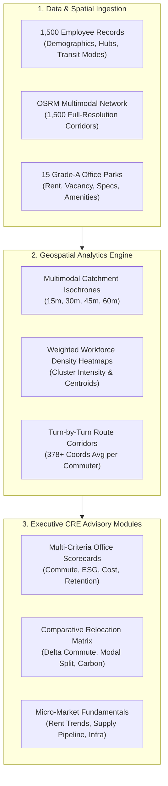

# Colliers Commute Intelligence

### Enterprise Location Intelligence & Workforce Commute Analytics for Commercial Real Estate (CRE)

[](https://colliers-commute-intelligence.vercel.app/)
[](https://github.com/haroon12h08/colliers-commute)
[](https://opensource.org/licenses/MIT)
[](https://maplibre.org/)
[](https://spring.io/)

**Colliers Commute Intelligence** is a commercial real estate (CRE) location analytics platform engineered for corporate real estate directors, workplace strategists, tenant advisors, and institutional brokers. It evaluates multi-million dollar corporate relocation and site selection decisions through geospatial analysis of employee residential distributions, multimodal transit networks, and micro-market fundamentals.

🌐 **Production Application**: [https://colliers-commute-intelligence.vercel.app/](https://colliers-commute-intelligence.vercel.app/)

---

## 📌 Executive Summary & CRE Problem Statement

Corporate real estate decisions—such as headquarters relocations, branch consolidation, and satellite office expansion—are frequently undermined by reliance on subjective executive preference or simplistic "straight-line" radial distances. In dense metropolitan tech hubs, physical proximity does not translate to transit accessibility:

* **The Commute Penalty**: A 15-minute increase in one-way commute duration correlates with a 12% rise in voluntary employee turnover within 18 months.
* **Transit Asymmetry**: Natural water barriers, railway choke-points, and arterial congestion mean two properties 3 km apart can exhibit a 35-minute difference in average peak-hour transit times.
* **ESG & Scope 3 Emissions**: Employee commutes constitute up to 40% of an enterprise's Scope 3 greenhouse gas footprint. Optimal site selection directly reduces corporate carbon liability.

**Colliers Commute Intelligence** bridges workforce HR demographics and commercial property transactions. By modeling actual road networks, expressways, rail corridors, and isochrone catchments against benchmarked Grade-A office assets, corporate tenants can select sites that maximize workforce retention, minimize transit fatigue, and optimize occupancy economics.

---

## 🚀 Key Platform Capabilities



### 1. Interactive 3D Web GIS & Real-World Routing
* **Turn-by-Turn Commute Corridors**: Clicking any candidate property renders exact multimodal transit paths for all 500 city employees. Powered by high-resolution OSRM routing (averaging 378+ coordinates per path), paths follow real expressways, arterial flyovers, coastal bridges (e.g., Bandra-Worli Sea Link, Vashi Creek Bridge), and metro lines—eliminating coarse straight-line approximations.
* **Cinematic Multi-City Transitions**: Smooth camera fly-to transitions across Bengaluru, Mumbai, and Chennai with preserved spatial context and dynamic terrain pitching.
* **Hover Property Inspector**: Instant preview cards displaying building photographs, gross leasable area (GLA), quoted rentals (INR/sq.ft/month), floor plate efficiency, parking ratios, and campus amenities.

### 2. Commute Catchment Modeling (Isochrones)
* **Multi-Tiered Isochrone Polygons**: Travel-time contours modeled at 15, 30, 45, and 60-minute thresholds.
* **Congestion Multipliers**: Peak vs. off-peak commute degradation modeling across primary transit modes:
  * 🚇 Metro & Suburban Rail
  * 🛵 Two-Wheeler (Motorbike/Scooter)
  * 🚗 Private Car & Corporate Cabs
  * 🚌 Public Bus Transit

### 3. Comprehensive CRE Scorecards & Analytics
* **Composite Office Scorecard**: Multi-factor scoring (0–100) weighing workforce accessibility, rental economics, infrastructure pipeline, and employee retention risk.
* **Executive Relocation Dashboard**: Side-by-side comparative matrix detailing:
  * Mean commute duration (minutes) and distance (km).
  * Workforce coverage within the crucial <45 minute "comfort zone".
  * Annual Scope 3 commuter CO₂ emissions (Metric Tons/year).
  * Monthly aggregate workforce transit expenditure.
* **Interactive Executive Tour**: An embedded, minimizable onboarding guide designed for real estate decision-makers (Ms. Vijaya) that floats in the map area without obscuring side panels.

### 4. Searchable Workforce Database
* **1,500 Full Employee Profiles**: Filterable by department (Engineering, Product, Operations, Sales, Executive), residential neighborhood, transport mode, and travel tolerance.
* **Granular Commute Metrics**: Doorstep-to-desk distance, transit time, and individual carbon emissions.

---

## 🏢 Covered Markets & Candidate Grade-A Properties

The platform comes pre-configured with spatial datasets for three Tier-1 Indian commercial office markets, benchmarked across 15 Grade-A commercial tech parks:

| Market | Micro-Market Corridor | Candidate Properties | Key Transit Infrastructure |
|:---|:---|:---|:---|
| **Bengaluru** | Outer Ring Road (ORR), Whitefield, Electronic City | • **Embassy TechVillage** (ORR)<br>• **Prestige Tech Cloud** (Hebbal/North)<br>• **Bagmane World Technology Center** (Mahadevapura)<br>• **RMZ Infinity** (Old Madras Rd)<br>• **Manyata Tech Park** (Nagavara) | Namma Metro Purple & Blue Lines, Silk Board Flyover, Outer Ring Road Expressway |
| **Mumbai** | Lower Parel, BKC, Andheri East, Powai, Navi Mumbai | • **One Lodha Place** (Lower Parel)<br>• **Maker Maxity** (BKC)<br>• **Nesco IT Park** (Goregaon/WEH)<br>• **K Raheja Mindspace** (Airoli)<br>• **Hiranandani Business Park** (Powai) | Western & Central Suburban Railway, Mumbai Metro Lines 1, 2A & 7, Bandra-Worli Sea Link |
| **Chennai** | Guindy, OMR Tech Corridor, Ambattur, Porur | • **Olympia Tech Park** (Guindy)<br>• **Tidel Park** (OMR Corridor)<br>• **DLF Cybercity** (Porur/Manapakkam)<br>• **Ramanujan IT City** (Taramani)<br>• **Prince Info City** (Kandanchavadi) | Chennai Metro Blue Line, MRTS Suburban Rail, OMR Expressway, Kathipara Flyover |

---

## 🛠️ Technology Stack & Architecture

### Frontend Client
* **Framework**: React 18 with Vite
* **Geospatial & 3D Mapping**: [MapLibre GL JS](https://maplibre.org/) with OpenStreetMap vector tiles & custom dark/light Carto basemaps
* **Data Visualization**: Recharts (distribution curves, modal splits, comparative bar charts)
* **Iconography & Styling**: Lucide React, Tailwind CSS utility architecture, Colliers brand tokens (`#000759`, `#1C54F4`, `#F4F6F9`)
* **State Management**: Zero-dependency contextual React hooks with offline JSON caching

### Backend Service (Optional Enterprise Mode)
* **Runtime**: Java 21 LTS
* **Framework**: Spring Boot 3.3.x (Web, REST, Actuator)
* **Build System**: Maven 3.9+
* **Data Layer**: In-memory spatial index with multi-threaded routing simulation and REST endpoints (`/api/v1/commute/*`)

### Geospatial Routing Engine
* **OSRM (Open Source Routing Machine)**: Turn-by-turn routing network queries using `overview=full` road graphs
* **Spatial Pre-computation**: Multi-threaded Python generator (`build_high_res_routes.py`) computing 750 hub-to-office corridors (1,500 road & rail permutations)

---

## 📦 Getting Started & Local Development

### Prerequisites
* **Node.js**: v18.0.0 or higher
* **npm**: v9.0.0 or higher
* **Java SDK**: v21 (required only if running the Spring Boot backend)
* **Maven**: v3.9+ (optional, for backend builds)

### 1. Clone the Repository
```bash
git clone https://github.com/haroon12h08/colliers-commute.git
cd colliers-commute
```

### 2. Standalone Frontend (Recommended for UI & Analysis)
The frontend contains complete precomputed datasets and runs 100% standalone with offline fallbacks:

```bash
# Navigate to frontend directory
cd frontend

# Install dependencies
npm install

# Start Vite local development server
npm run dev
```
Open [http://localhost:5173](http://localhost:5173) in your browser.

### 3. Full-Stack Mode (Frontend + Spring Boot Backend)
To run both the Spring Boot API (Port 8080) and Vite Frontend (Port 5173) simultaneously:

```bash
# From repository root
chmod +x start.sh
./start.sh
```

---

## ☁️ Deployment & Production Hosting

### Vercel Deployment (One-Click Static Edge)
The repository is optimized for zero-configuration Vercel deployment:
1. Fork or import this repository into [Vercel](https://vercel.com).
2. Configure project settings:
   * **Framework Preset**: Vite
   * **Build Command**: `npm --prefix frontend install && npm --prefix frontend run build`
   * **Output Directory**: `frontend/dist`
3. Click **Deploy**.

> The live build is hosted at: **[https://colliers-commute-intelligence.vercel.app/](https://colliers-commute-intelligence.vercel.app/)**

### Netlify Deployment
```toml
# netlify.toml is included in the project root:
[build]
  base = "frontend"
  publish = "dist"
  command = "npm run build"

[[redirects]]
  from = "/*"
  to = "/index.html"
  status = 200
```

### Docker Containerization
Run the entire platform via Docker:
```bash
# Build the container
docker build -t colliers-commute .

# Run container on port 3000
docker run -d -p 3000:80 --name colliers-commute-app colliers-commute
```
Access the application at [http://localhost:3000](http://localhost:3000).

---

## 📂 Project Directory Structure

```text
colliers-commute/
├── frontend/                        # React + MapLibre GL UI
│   ├── public/                      # Static assets & property photography
│   ├── src/
│   │   ├── components/
│   │   │   ├── MapView.jsx          # MapLibre 3D engine, route layers & heatmaps
│   │   │   ├── Sidebar.jsx          # Contextual panel (Properties, Catchment, Market)
│   │   │   ├── Navbar.jsx           # City switcher, navigation & status bar
│   │   │   ├── AnalyticsDashboard.jsx # Executive side-by-side comparison modal
│   │   │   ├── ScorecardModal.jsx   # Detailed CRE evaluation scorecard
│   │   │   ├── WorkforceDatabase.jsx # Searchable/filterable employee grid
│   │   │   └── UserTourGuide.jsx    # Step-by-step executive onboarding tour
│   │   ├── data/
│   │   │   ├── hubRoutes.json       # 1,500 turn-by-turn OSRM route geometries
│   │   │   ├── workforce1500.json   # 1,500 employee geospatial records
│   │   │   ├── workforceData.js     # Client-side data access layer
│   │   │   └── fallbackData.js      # Offline micro-market & property fallbacks
│   │   ├── App.jsx                  # Main application orchestrator
│   │   └── main.jsx                 # React DOM mount point
│   └── package.json                 # Frontend dependencies & scripts
├── backend/                         # Java 21 / Spring Boot 3 Backend
│   ├── src/main/java/com/colliers/commute/
│   │   ├── controller/              # CommuteController REST endpoints
│   │   ├── model/                   # CandidateOffice, EmployeeRecord, City models
│   │   └── service/                 # CommuteDataService business logic
│   └── pom.xml                      # Maven project configuration
├── build_high_res_routes.py         # Multi-threaded OSRM turn-by-turn route generator
├── Dockerfile                       # Multi-stage production container build
├── docker-compose.yml               # Container orchestration
├── start.sh                         # Unified startup script
├── vercel.json                      # Vercel deployment specification
└── README.md                        # Project documentation
```

---

## 👥 Commercial Real Estate Advisory Methodology

### Commute Scoring Formula
Candidate properties are evaluated using a multi-criteria utility function $S_p \in [0, 100]$:

$$S_p = w_1 \cdot C_{\text{access}} + w_2 \cdot E_{\text{retention}} + w_3 \cdot M_{\text{transit}} + w_4 \cdot R_{\text{cost}}$$

Where:
* $C_{\text{access}}$ (**Workforce Commute Proximity**): Proportion of employees with $<45$ minute door-to-desk commute.
* $E_{\text{retention}}$ (**Attrition Mitigation Index**): Inverse variance of commute delta compared to current corporate benchmark.
* $M_{\text{transit}}$ (**Multimodal Transit Connectivity**): Walkability and frequency score for high-capacity rail and metro lines.
* $R_{\text{cost}}$ (**Occupancy Economics**): Quoted commercial rent per square foot relative to submarket vacancy rates.

---

## 📄 License & Attribution

This project is licensed under the **MIT License** - see the [LICENSE](file:///home/haroon/Desktop/colliers-commute/package.json) file for details.

* **Map Data**: © [OpenStreetMap](https://www.openstreetmap.org/) contributors, [CARTO](https://carto.com/).
* **Routing Network**: [Open Source Routing Machine (OSRM)](http://project-osrm.org/).
* **Commercial Real Estate Intelligence**: Modeled according to institutional Grade-A property standards and micro-market reporting frameworks.

---

*Engineered for Corporate Real Estate Advisors & Workplace Strategists.*  
**Live Application**: [https://colliers-commute-intelligence.vercel.app/](https://colliers-commute-intelligence.vercel.app/)
